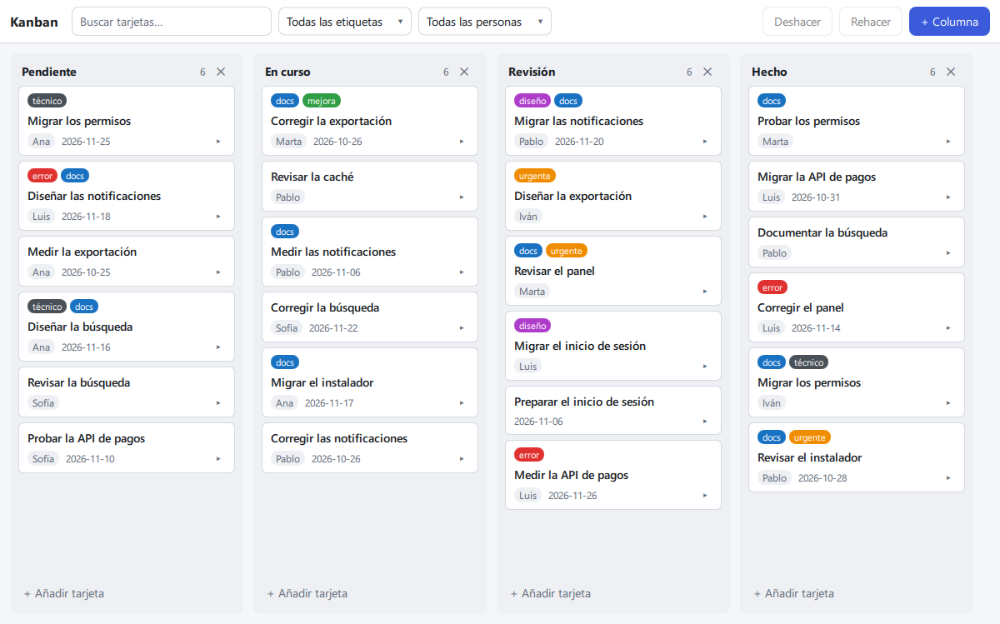
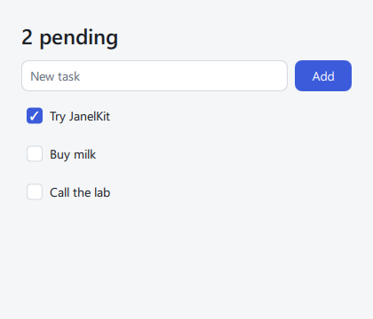

<h1 align="center">JanelKit</h1>

<p align="center">
  <b>Una ventana nueva para Python.</b><br>
  Aplicaciones de escritorio escritas por completo en Python, un archivo por componente, dibujadas con Qt Quick.
</p>

<p align="center">
  <a href="https://pypi.org/project/janelkit/"></a>
  <a href="https://pypi.org/project/janelkit/"></a>
  <a href="https://github.com/janelkit/janelkit/actions/workflows/ci.yml"></a>
  <a href="LICENSE"></a>
</p>

<p align="center"><a href="README.md">Read in English</a></p>

<p align="center">
  
  <br>
  <sub>Un tablero Kanban hecho con JanelKit: 842 líneas de <code>.janel</code> y Python, y 12 pruebas que corren sin pantalla. <a href="apps/challenges/kanban">Código</a></sub>
</p>

```bash
pip install janelkit
janel new mi-app
cd mi-app
python main.py
```

## Un archivo por componente

Un archivo `.janel` reúne la lógica, la plantilla y los estilos de un componente. Todo lo que va entre `{` y `}` es Python, y la interfaz sigue a tu estado: cuando cambia un valor, solo se actualiza lo que depende de él.

```html
<script lang="python">
from janelkit import state, computed

todos = state([{"id": 1, "title": "Try JanelKit", "done": False}])
draft = state("")

@computed
def pending():
    return sum(not t["done"] for t in todos.value)

def add():
    todos.value.append({"id": len(todos.value) + 1, "title": draft.value, "done": False})
    draft.value = ""
</script>

<window title="Tasks" width={420} height={360}>
  <column class="page">
    <text class="title">{pending} pending</text>
    <row class="new">
      <textfield bind:value={draft} on:submit={add} placeholder="New task" flex={1} />
      <button variant="primary" on:click={add}>Add</button>
    </row>
    {#each todos as todo (todo["id"])}
      <checkbox checked={todo["done"]} on:change={todo["done"] = event}>{todo["title"]}</checkbox>
    {/each}
  </column>
</window>

<style>
.page { padding: 24px; gap: 12px; }
.title { font-size: var(--font-size-xl); font-weight: 600; }
.new { gap: 8px; }
</style>
```

<p align="center"></p>

Su prueba maneja la aplicación como lo haría un usuario, sin abrir ninguna ventana:

```python
from janelkit.inspect import mount

def test_add_a_task():
    with mount("src/App.janel") as app:
        app.find(placeholder="New task").type("Buy milk").submit()
        app.find("checkbox", text="Buy milk").check()
        assert "1 pending" in app.texts()
```

Las etiquetas en minúscula vienen con JanelKit (`<text>`, `<button>`, `<column>`). Las que empiezan por mayúscula son componentes que importas como cualquier módulo de Python (`from components.TodoItem import TodoItem`).

## Por qué JanelKit

- **Un solo lenguaje.** La lógica, las expresiones de la plantilla y las pruebas son Python. Nunca escribes JavaScript ni QML: el QML lo genera el compilador.
- **Tus bibliotecas en el mismo proceso.** Un array de NumPy, un fotograma de OpenCV o el resultado de un modelo llegan directamente a la interfaz, sin servidor de por medio y sin serializar nada. `<video>` muestra fotogramas que se envían desde cualquier hilo: a 1080p llegan a la pantalla en 17 ms (mediana) en un portátil de 2013. [Cifras y límites](docs/patrones.md#qué-latencia-esperar-y-para-qué-no-sirve)
- **Errores que señalan tu código.** `janel build` revisa todos los componentes antes de que se ejecute nada. Los errores, también los de Qt y los que surgen al ejecutar, llegan con el archivo `.janel`, la línea, la columna y una sugerencia cuando la hay.
- **Guarda y míralo.** `janel dev` recarga la ventana al guardar y conserva el estado de cada componente cuyo script no cambió.
- **Pruebas sin pantalla.** `janelkit.inspect` monta la aplicación sin ventana y la maneja como un usuario. Así corren las propias pruebas de JanelKit en Windows, macOS y Linux.
- **Un núcleo pequeño.** La navegación, los datos compartidos, los diálogos del sistema y las traducciones son paquetes aparte, que añades cuando los necesitas.

## ¿Es para ti?

**Encaja bien:** herramientas de escritorio que trabajan con datos en vivo, cámaras o modelos (inspección, etiquetado, paneles de laboratorio y de máquinas), herramientas internas y cualquier aplicación cuya lógica ya esté en Python.

**Lo que hoy no cubre:**

- Aplicaciones web y móviles: JanelKit es para el escritorio.
- Instaladores y firma de código: hay una [receta con PyInstaller](docs/desarrollo.md#distribuir-un-ejecutable-con-pyinstaller); MSI, DMG y AppImage quedan de tu parte.
- Vídeo que necesite menos de un refresco de pantalla de latencia, plazos estrictos o audio: mira [para qué no sirve](docs/patrones.md#qué-latencia-esperar-y-para-qué-no-sirve).

## Aprende

| Guía | Qué contiene |
|---|---|
| [Tutorial](docs/tutorial.md) | **Empieza aquí:** una aplicación completa, paso a paso |
| [Lenguaje](docs/lenguaje.md) | El formato `.janel`: expresiones, bloques, componentes, elementos del núcleo |
| [Estilos](docs/estilos.md) | CSS soportado, disposición flex, tokens, temas claro y oscuro |
| [Patrones en tiempo real](docs/patrones.md) | Cámaras, modelos y adquisición de datos: ciclos, fotogramas, latencia |
| [Desarrollo](docs/desarrollo.md) | `janel dev`, `janel build`, errores, pruebas, ejecutables |
| [API pública](docs/api.md) · [Cambios](docs/cambios.md) | Qué es público, la política de versiones y cómo migrar |

[`apps/examples`](apps/examples) tiene aplicaciones pequeñas, una por tema. [`apps/challenges`](apps/challenges) tiene aplicaciones grandes que ponen a prueba el framework: un cliente de chat, un gestor de proyectos, el tablero Kanban de arriba, una hoja de cálculo de 10 000 × 26 y un monitor del sistema en tiempo real.

## Paquetes

`pip install janelkit` es todo lo que necesita una aplicación de una pantalla. Lo demás se añade cuando hace falta:

| Necesitas | Instala | Usa |
|---|---|---|
| Una aplicación: estado, plantilla, componentes, estilos, controles, ventanas, tareas, vídeo | `janelkit` | `state`, `<text>`, `<button>`, `<video>`, `open_window`… |
| Varias pantallas: pilas de páginas, barra lateral con secciones | [`janelkit-router`](packages/janelkit-router) | `pages`, `<Pages>`, `sections`, `<Sections>` |
| Datos que comparten varias vistas o ventanas, recordados entre sesiones | [`janelkit-store`](packages/janelkit-store) | `@store`, `use`, `persisted` |
| Diálogos de archivos y del sistema, portapapeles | [`janelkit-desktop`](packages/janelkit-desktop) | `dialogs`, `clipboard` |
| Traducciones | [`janelkit-i18n`](packages/janelkit-i18n) | `t`, `i18n` |
| Resaltado de `.janel` en VS Code | [`janelkit-vscode`](packages/janelkit-vscode) | — |

## Estado

**Alfa (0.2).** La API pública está documentada en [api.md](docs/api.md) y protegida por pruebas. Cada serie (0.1, 0.2…) puede romperla, siempre con notas de migración en [cambios.md](docs/cambios.md) y `janel migrate`. Python 3.10+ y PySide6 6.8+, en Windows, macOS y Linux.

## Contribuir

Los issues y las ideas son bienvenidos. [CONTRIBUTING.md](CONTRIBUTING.md) explica cómo correr las pruebas, cómo está organizado el repositorio y cómo se publican las versiones.

## Licencia

[MIT](LICENSE). JanelKit usa [PySide6](https://pypi.org/project/PySide6/) (Qt for Python), que se distribuye bajo LGPL-3.0: si empaquetas una aplicación con Qt incluido, revisa sus [condiciones](https://doc.qt.io/qtforpython-6/licenses.html).
