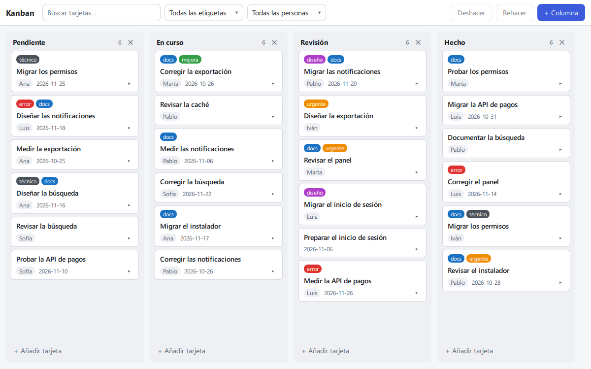
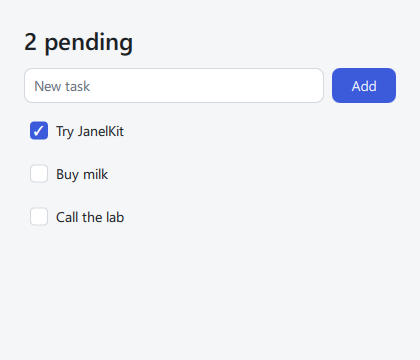

<h1 align="center">JanelKit</h1>

<p align="center">
  <b>A new window for Python.</b><br>
  Desktop apps written entirely in Python, one file per component, rendered with Qt Quick.
</p>

<p align="center">
  <a href="https://pypi.org/project/janelkit/"></a>
  <a href="https://pypi.org/project/janelkit/"></a>
  <a href="https://github.com/janelkit/janelkit/actions/workflows/ci.yml"></a>
  <a href="LICENSE"></a>
</p>

<p align="center"><a href="README.es.md">Leer en español</a></p>

<p align="center">
  
  <br>
  <sub>A Kanban board built with JanelKit: 842 lines of <code>.janel</code> and Python, and 12 tests that run without a screen. <a href="apps/challenges/kanban">Source</a></sub>
</p>

```bash
pip install janelkit
janel new my-app
cd my-app
python main.py
```

## One file per component

A `.janel` file holds a component's logic, template and styles. Everything between `{` and `}` is Python, and the interface follows your state: when a value changes, only what depends on it is updated.

```html
<script lang="python">
from janelkit import state, computed

todos = state([{"id": 1, "title": "Try JanelKit", "done": False}])
draft = state("")

@computed
def pending():
    return sum(not t["done"] for t in todos.value)

def add():
    todos.value.append({"id": len(todos.value) + 1, "title": draft.value, "done": False})
    draft.value = ""
</script>

<window title="Tasks" width={420} height={360}>
  <column class="page">
    <text class="title">{pending} pending</text>
    <row class="new">
      <textfield bind:value={draft} on:submit={add} placeholder="New task" flex={1} />
      <button variant="primary" on:click={add}>Add</button>
    </row>
    {#each todos as todo (todo["id"])}
      <checkbox checked={todo["done"]} on:change={todo["done"] = event}>{todo["title"]}</checkbox>
    {/each}
  </column>
</window>

<style>
.page { padding: 24px; gap: 12px; }
.title { font-size: var(--font-size-xl); font-weight: 600; }
.new { gap: 8px; }
</style>
```

<p align="center"></p>

Its test drives the app the way a user would, without opening a window:

```python
from janelkit.inspect import mount

def test_add_a_task():
    with mount("src/App.janel") as app:
        app.find(placeholder="New task").type("Buy milk").submit()
        app.find("checkbox", text="Buy milk").check()
        assert "1 pending" in app.texts()
```

Lowercase tags come with JanelKit (`<text>`, `<button>`, `<column>`). Capitalized tags are components you import like any Python module (`from components.TodoItem import TodoItem`).

## Why JanelKit

- **One language.** Logic, template expressions and tests are Python. You never write JavaScript or QML: the compiler generates the QML.
- **Your libraries in the same process.** A NumPy array, an OpenCV frame or a model's result goes straight to the interface, with no server in between and nothing to serialize. `<video>` shows frames pushed from any thread: at 1080p they reach the screen in 17 ms (median) on a 2013 laptop. [Figures and limits](docs/patrones.md#qué-latencia-esperar-y-para-qué-no-sirve)
- **Errors that point at your code.** `janel build` checks every component before anything runs. Errors, including those raised by Qt or at run time, come back with the `.janel` file, line and column, and a suggestion when there is one.
- **Save and see it.** `janel dev` reloads the window when you save, and keeps the state of every component whose script didn't change.
- **Tests without a screen.** `janelkit.inspect` mounts the app headless and drives it like a user. JanelKit's own suite runs this way on Windows, macOS and Linux.
- **A small core.** Navigation, shared data, native dialogs and translations are separate packages that you add when you need them.

## Is it for you?

**A good fit:** desktop tools that work with live data, cameras or models (inspection, labeling, lab and machine dashboards), internal tools, and any app whose logic is already in Python.

**Not covered today:**

- Web and mobile apps: JanelKit is for the desktop.
- Installers and code signing: there is a [PyInstaller recipe](docs/desarrollo.md#distribuir-un-ejecutable-con-pyinstaller); MSI, DMG and AppImage are up to you.
- Video that needs less than one display refresh of latency, hard deadlines or audio: see [what it is not for](docs/patrones.md#qué-latencia-esperar-y-para-qué-no-sirve).
- English documentation: the guides and the compiler messages are in Spanish for now.

## Learn

The guides are in [`docs/`](docs) (Spanish):

| Guide | What's in it |
|---|---|
| [Tutorial](docs/tutorial.md) | **Start here:** a complete app, step by step |
| [Language](docs/lenguaje.md) | The `.janel` format: expressions, blocks, components, built-in elements |
| [Styles](docs/estilos.md) | Supported CSS, flex layout, tokens, light and dark themes |
| [Real-time patterns](docs/patrones.md) | Cameras, models and data acquisition: loops, frames, latency |
| [Development](docs/desarrollo.md) | `janel dev`, `janel build`, errors, tests, executables |
| [Public API](docs/api.md) · [Changes](docs/cambios.md) | What is public, the versioning policy and how to migrate |

[`apps/examples`](apps/examples) has small apps, one topic each. [`apps/challenges`](apps/challenges) has large apps that put the framework to the test: a chat client, a project manager, the Kanban board above, a 10 000 × 26 spreadsheet and a live system monitor.

## Packages

`pip install janelkit` is all a one-screen app needs. Add the rest when you need it:

| You need | Install | Use |
|---|---|---|
| An app: state, template, components, styles, controls, windows, tasks, video | `janelkit` | `state`, `<text>`, `<button>`, `<video>`, `open_window`… |
| Several screens: page stacks, a sidebar with sections | [`janelkit-router`](packages/janelkit-router) | `pages`, `<Pages>`, `sections`, `<Sections>` |
| Data shared by several views or windows, remembered between sessions | [`janelkit-store`](packages/janelkit-store) | `@store`, `use`, `persisted` |
| Native file and system dialogs, clipboard | [`janelkit-desktop`](packages/janelkit-desktop) | `dialogs`, `clipboard` |
| Translations | [`janelkit-i18n`](packages/janelkit-i18n) | `t`, `i18n` |
| `.janel` syntax highlighting in VS Code | [`janelkit-vscode`](packages/janelkit-vscode) | — |

## Status

**Alpha (0.2).** The public API is documented in [api.md](docs/api.md) and protected by tests. Each series (0.1, 0.2…) may break it, always with migration notes in [cambios.md](docs/cambios.md) and `janel migrate`. Python 3.10+ and PySide6 6.8+, on Windows, macOS and Linux.

## Contributing

Issues and ideas are welcome. [CONTRIBUTING.md](CONTRIBUTING.md) explains how to run the suite, how the repository is organized and how versions are published.

## License

[MIT](LICENSE). JanelKit uses [PySide6](https://pypi.org/project/PySide6/) (Qt for Python), distributed under LGPL-3.0: if you ship an app that bundles Qt, review its [terms](https://doc.qt.io/qtforpython-6/licenses.html).
