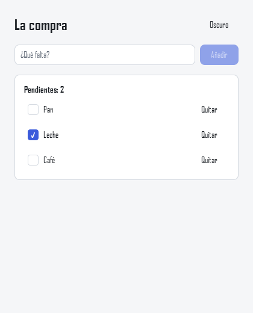

# Tutorial: una lista de la compra

En este tutorial se construye, de principio a fin, una aplicación de escritorio con JanelKit: una lista de la compra que se guarda sola en disco. Por el camino aparecen el estado reactivo, las listas, los componentes, los estilos, el trabajo en segundo plano y las pruebas.

Necesitas Python 3.10 o posterior. Tiempo estimado: 30 minutos. El código completo está en `examples/compra`.



## 1. Crear el proyecto

```bash
python -m venv .venv
.venv\Scripts\activate            # Linux/macOS: source .venv/bin/activate
pip install janelkit                 # mientras no esté en PyPI: pip install -e <carpeta de JanelKit>

janel new compra
cd compra
janel dev
```

`janel new` crea el proyecto y `janel dev` lo abre. Déjalo abierto: cada vez que guardes un `.janel`, la ventana se actualiza sola.

```
compra/
  main.py              ← arranque: python main.py
  src/
    App.janel           ← el componente raíz
    components/        ← otros componentes .janel
    services/          ← código Python normal
```

Borra `src/components/Counter.janel` y `src/services/users.py`, que son del ejemplo inicial.

## 2. Estado y eventos

Sustituye `src/App.janel` por esto:

```html
<script lang="python">
from janelkit import state

items = state([])
draft = state("")


def add():
    name = draft.value.strip()
    if name:
        next_id = max((i["id"] for i in items.value), default=0) + 1
        items.value.append({"id": next_id, "name": name, "done": False})
        draft.value = ""
</script>

<Window title="Lista de la compra" width={420} height={520}>
  <Column class="page">
    <Text class="title">La compra</Text>
    <Row class="new">
      <TextField bind:value={draft} on:submit={add} placeholder="¿Qué falta?" flex={1} />
      <Button variant="primary" on:click={add} enabled={bool(draft.strip())}>Añadir</Button>
    </Row>
    <Text>{len(items)} productos</Text>
  </Column>
</Window>

<style>
.page { padding: 24px; gap: 16px; }
.title { font-size: var(--font-size-xl); font-weight: 600; }
.new { gap: 8px; }
</style>
```

- `state(...)` crea un valor **reactivo**. En Python se lee y escribe con `.value`; en la plantilla se usa sin `.value`.
- `bind:value={draft}` enlaza el campo con el estado en las dos direcciones.
- `on:submit` (Intro en el campo) y `on:click` llaman a `add`.
- `items.value.append(...)` actualiza la interfaz: las listas y diccionarios de un `state` avisan cuando se modifican.
- `enabled={bool(draft.strip())}` se recalcula solo cuando cambia `draft`.

## 3. Mostrar la lista

Cambia `<Text>{len(items)} productos</Text>` por un bloque `{#each}`:

```html
{#each items as item (item["id"])}
  <Row class="row">
    <Checkbox checked={item["done"]} on:change={item["done"] = event} flex={1}>{item["name"]}</Checkbox>
    <Button variant="ghost" on:click={items.remove(item)}>Quitar</Button>
  </Row>
{:else}
  <Text class="muted">La lista está vacía.</Text>
{/each}
```

y añade a `<style>`: `.row { gap: 8px; align-items: center; }` y `.muted { color: var(--text-muted); }`.

- `(item["id"])` es la **clave** de cada fila: al borrar o reordenar, cada fila conserva su identidad.
- `on:change={item["done"] = event}` es un **manejador en línea**: `event` es lo que manda el control (si quedó marcado).
- `{:else}` se muestra cuando la lista está vacía.

## 4. Un valor calculado

Para contar lo pendiente, añade al script:

```python
from janelkit import state, computed

@computed
def pending():
    return sum(not i["done"] for i in items.value)
```

y úsalo en la plantilla: `<Text>Pendientes: {pending}</Text>`. Un `computed` se recalcula solo cuando cambia algo de lo que leyó: marcar una casilla actualiza el contador.

## 5. Componentes

Cuando una parte de la interfaz crece, sepárala en un componente. Crea `src/components/ItemRow.janel`:

```html
<script lang="python">
from janelkit import prop, event

item = prop()        # lo pasa el padre
toggled = event()    # avisos hacia el padre
removed = event()
</script>

<Row class="row">
  <Checkbox checked={item["done"]} on:change={toggled.emit(event)} flex={1}>{item["name"]}</Checkbox>
  <Button variant="ghost" on:click={removed.emit()}>Quitar</Button>
</Row>

<style>
.row { gap: 8px; align-items: center; }
</style>
```

Y `src/components/Card.janel`, una tarjeta que recibe contenido con `<Slot />`:

```html
<script lang="python">
from janelkit import prop

title = prop()
</script>

<Column class="card">
  <Text class="title">{title}</Text>
  <Slot />
</Column>

<style>
.card { padding: 16px; gap: 8px; background: var(--surface); border: 1px solid var(--border); border-radius: var(--radius); }
.title { font-weight: 600; }
</style>
```

En `App.janel`, impórtalos y úsalos:

```python
from components.Card import Card
from components.ItemRow import ItemRow
```

```html
<Card title={f"Pendientes: {pending}"}>
  {#each items as item (item["id"])}
    <ItemRow item={item} on:toggled={item["done"] = event} on:removed={items.remove(item)} />
  {:else}
    <Text class="muted">La lista está vacía.</Text>
  {/each}
</Card>
```

- Las **props** son de solo lectura en el hijo; para cambiar algo, el hijo emite un **evento** y el padre decide.
- Lo que va entre `<Card>` y `</Card>` aparece donde la tarjeta pone `<Slot />`, y se evalúa en el padre: ve `items`, `pending`…
- Si te equivocas de nombre (`<ItemRow itme={...}>`), el compilador lo dice con archivo, línea y sugerencia.

## 6. Tema claro y oscuro

Los colores de `var(--surface)`, `var(--border)`… vienen del tema. Añade un botón para cambiarlo:

```python
from janelkit import theme
```

```html
<Row class="header">
  <Text class="title">La compra</Text>
  <Spacer />
  <Button variant="ghost" on:click={theme.toggle()}>{"Oscuro" if theme.name == "light" else "Claro"}</Button>
</Row>
```

con `.header { align-items: center; }` en el estilo.

## 7. Guardar en disco sin bloquear la ventana

Leer y escribir archivos bloquea; la interfaz no debe esperar. Crea `src/services/storage.py` con código Python normal:

```python
"""Guarda la lista en un archivo JSON. Funciones normales (bloqueantes)."""
import json
import os
from pathlib import Path


def data_file() -> Path:
    # Se consulta en cada llamada: así las pruebas pueden usar otro archivo.
    return Path(os.environ.get("COMPRA_FILE", Path.home() / ".lista-compra.json"))


def load() -> list[dict]:
    file = data_file()
    if not file.exists():
        return []
    return json.loads(file.read_text(encoding="utf-8"))


def save(items: list[dict]) -> None:
    data_file().write_text(json.dumps(items, ensure_ascii=False, indent=2), encoding="utf-8")
```

En el script de `App.janel`:

```python
from janelkit import state, computed, effect, task, background, on_mount, theme
from services import storage

loaded = state(False)  # no guardar nada hasta haber leído lo que ya había


@task
async def load():
    items.value = await background(storage.load)
    loaded.value = True


@task
async def save(data):
    await background(storage.save, data)


@on_mount
def start():
    load.run()


def autosave():
    if loaded.value:
        data = [dict(i) for i in items.value]  # copia simple, leída en el hilo de la interfaz
        save.run(data)


effect(autosave)
```

- `await background(f, ...)` ejecuta `f` en otro hilo y devuelve su resultado; mientras tanto la ventana responde.
- `@task` da a la operación estado reactivo: `load.loading`, `save.error`… Por ejemplo, en la plantilla:

  ```html
  {#if save.error}
    <Text class="error">No se pudo guardar: {save.error}</Text>
  {/if}
  ```

- `effect(autosave)` se ejecuta ahora y cada vez que cambia algo de lo que leyó: añadir, marcar o quitar guarda la lista. `save.run` cancela un guardado anterior que siguiera en curso.
- **¿Por qué `loaded`?** El efecto se ejecuta en cuanto se crea, antes de que termine la carga. Sin esa espera, guardaría la lista vacía encima de la que había en disco.
- `on_mount` se ejecuta cuando la ventana ya existe.
- El código de `background` no debe tocar el estado: devuelve un valor y se asigna tras el `await`. Por eso `autosave` prepara una copia simple de los datos en el hilo de la interfaz.

## 8. Probar la aplicación

`janelkit.inspect` monta la aplicación sin ventana y la maneja como lo haría un usuario. Crea `tests/test_app.py`:

```python
import json

from janelkit.inspect import mount


def test_add_check_and_remove(tmp_path, monkeypatch):
    file = tmp_path / "lista.json"
    monkeypatch.setenv("COMPRA_FILE", str(file))

    with mount("src/App.janel") as app:
        app.wait(until=lambda: app.get("loaded"))
        assert "La lista está vacía." in app.texts()

        app.find(placeholder="¿Qué falta?").type("Pan").submit()
        app.find(placeholder="¿Qué falta?").type("Leche").submit()
        assert app.find("Card").visible  # los componentes se buscan por su nombre
        assert "Pendientes: 2" in app.texts()

        app.find("Checkbox", text="Pan").check()
        assert "Pendientes: 1" in app.texts()

        app.find_all("Button", text="Quitar")[1].click()  # quita «Leche»
        assert [i["name"] for i in app.get("items")] == ["Pan"]

        app.wait(until=lambda: not app.get("save").loading)
        assert json.loads(file.read_text(encoding="utf-8")) == [{"id": 1, "name": "Pan", "done": True}]


def test_loads_the_saved_list(tmp_path, monkeypatch):
    file = tmp_path / "lista.json"
    file.write_text('[{"id": 7, "name": "Café", "done": false}]', encoding="utf-8")
    monkeypatch.setenv("COMPRA_FILE", str(file))

    with mount("src/App.janel") as app:
        app.wait(until=lambda: app.get("loaded"))
        assert app.find("Checkbox", text="Café").value is False
```

```bash
pip install pytest
pytest
```

Estas pruebas encontraron, al escribir este tutorial, el error de guardar antes de cargar del paso 7.

## 9. Distribuirla

- `janel build` comprueba todos los componentes sin abrir la ventana: útil antes de publicar o en la CI.
- Para crear un ejecutable que se pueda dar a quien no tiene Python, sigue la receta de [empaquetado.md](empaquetado.md).

## Siguientes pasos

- [lenguaje.md](lenguaje.md): todo el formato `.janel`, los elementos disponibles, `<List>` para listas grandes, diálogos, accesibilidad y elementos propios en QML.
- [estilos.md](estilos.md): propiedades de estilo, `flex` y temas.
- [desarrollo.md](desarrollo.md): `janel dev`, errores y pruebas.
- Los ejemplos de `examples/`, en especial `files` (explorador de archivos) y `books` (cliente de una API).
