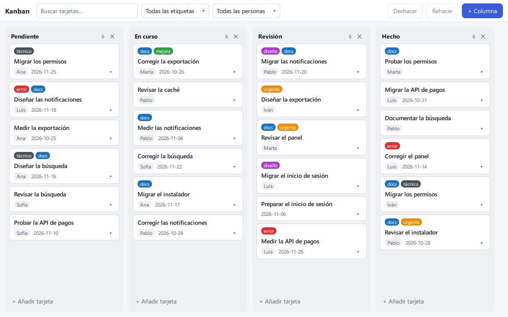
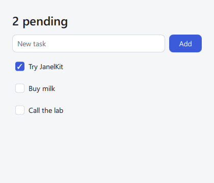

# JanelKit

[](https://pypi.org/project/janelkit/)
[](https://pypi.org/project/janelkit/)
[](https://github.com/janelkit/janelkit/actions/workflows/ci.yml)
[](https://github.com/janelkit/janelkit/blob/main/LICENSE)

**Modern desktop apps in pure Python.** Tests click every button without a screen, so you, your CI and your coding agent can see the app work.

<p align="center">
  
  <br>
  <sub>A Kanban board built with JanelKit: 842 lines of <code>.janel</code> and Python, and 12 tests that run without a screen. <a href="https://github.com/janelkit/janelkit/tree/main/apps/challenges/kanban">Source</a></sub>
</p>

```bash
pip install janelkit
janel new my-app
cd my-app
python main.py
```

**Next:** the [tutorial](https://github.com/janelkit/janelkit/blob/main/docs/tutorial.md) builds a complete app, step by step.

## One file per component

A `.janel` file holds a component's logic, template and styles. Everything between `{` and `}` is Python, and the interface follows your state: when a value changes, only what depends on it is updated.

```html
<script lang="python">
from janelkit import state, computed

todos = state([{"id": 1, "title": "Try JanelKit", "done": False}])
draft = state("")

@computed
def pending():
    return sum(not t["done"] for t in todos.value)

def add():
    todos.value.append({"id": len(todos.value) + 1, "title": draft.value, "done": False})
    draft.value = ""
</script>

<window title="Tasks" width={420} height={360}>
  <column class="page">
    <text class="title">{pending} pending</text>
    <row class="new">
      <textfield bind:value={draft} on:submit={add} placeholder="New task" flex={1} />
      <button variant="primary" on:click={add}>Add</button>
    </row>
    {#each todos as todo (todo["id"])}
      <checkbox checked={todo["done"]} on:change={todo["done"] = event}>{todo["title"]}</checkbox>
    {/each}
  </column>
</window>

<style>
.page { padding: 24px; gap: 12px; }
.title { font-size: var(--font-size-xl); font-weight: 600; }
.new { gap: 8px; }
</style>
```

<p align="center"></p>

Lowercase tags come with JanelKit (`<text>`, `<button>`, `<column>`). Capitalized tags are components you import like any Python module (`from components.TodoItem import TodoItem`).

## Tested the way it is used

`janelkit.inspect` mounts the app without a window and drives it like a user. This is the test for the component above:

```python
from janelkit.inspect import mount

def test_add_a_task():
    with mount("src/App.janel") as app:
        app.find(placeholder="New task").type("Buy milk").submit()
        app.find("checkbox", text="Buy milk").check()
        assert "1 pending" in app.texts()
```

There is no display, browser or driver to set up: it runs wherever `pytest` runs. A large app is tested the same way. These lines are from the [tests of the Kanban board](https://github.com/janelkit/janelkit/blob/main/apps/challenges/tests/test_challenge_kanban.py) (its labels are in Spanish):

```python
app.find("Tarjeta", label="Beta").drag_to(app.find("Columna", label="Hecho"))  # press, move, release
app.find("Tarjeta", label="Gamma").right_click()                               # opens the context menu
app.find("flex", label="Mover a «Hecho»").click()
app.find("Tarjeta", label="Beta").key("Enter")                                 # opens the card
assert app.find("Detalle").visible
app.screenshot("board.png")
```

- **It finds what a user sees.** `find` looks an element up by tag, text, label, placeholder or id, only among the visible ones, and fails unless exactly one matches.
- **It acts through the real paths.** `click`, `type`, `check`, `drag_to` and `key` emit the same signals a user would, so they go through your handlers and your `bind:`. Acting on a disabled control fails, as it would for a user.
- **It reaches the whole app.** Async tasks and timers (`app.wait(until=...)`), other windows, system dialogs, the script's state (`app.get("todos")`) and screenshots.

JanelKit's own suite, more than 650 tests, runs this way on Windows, macOS and Linux. [Reference](https://github.com/janelkit/janelkit/blob/main/docs/api.md#janelkitinspect-pruebas-y-herramientas)

## Built for coding agents too

An agent can't look at a window, but it can run a command. With JanelKit it can close the whole loop on its own:

1. **Write** a component.
2. **Check** it: `janel build` reports every error with the `.janel` file, line and column, without running anything.
3. **Use** it: `mount` the app, click, type and drag through it.
4. **Look** at it: `app.texts()` returns the visible text in reading order, and `app.screenshot()` the image.

No display, no browser, no extra tools: the same API your tests use.

## Why JanelKit

- **Python all the way.** Logic, template expressions and tests are Python, and the compiler generates the QML. When you need something from Qt Quick that JanelKit doesn't have, a `.qml` file of your own is imported like any other component. [Your own QML elements](https://github.com/janelkit/janelkit/blob/main/docs/lenguaje.md#elementos-propios-en-qml)
- **Your libraries in the same process.** A NumPy array, a pandas table or a model's result goes straight to the interface, with no server in between and nothing to serialize.
- **Native rendering.** Qt Quick draws the interface on the GPU. There is no browser or webview inside your app.
- **Errors that point at your code.** Errors from the compiler, from Qt or at run time come back with the `.janel` file, line and column, and a suggestion when there is one.

And the day-to-day: `janel dev` reloads the window when you save and keeps the state of every component you didn't touch, and the [VS Code extension](https://github.com/janelkit/janelkit/tree/main/packages/janelkit-vscode) (or `janel lsp` in any editor) underlines errors as you type.

## Is it for you?

**A good fit:** internal tools, data and lab tools, and any desktop app whose logic is already in Python and that you want covered by tests.

**Not covered today:**

- Web and mobile: JanelKit is for the desktop.
- Installers and code signing: there is a [PyInstaller recipe](https://github.com/janelkit/janelkit/blob/main/docs/desarrollo.md#distribuir-un-ejecutable-con-pyinstaller); MSI, DMG and AppImage are up to you.
- English documentation: the guides and the compiler messages are in Spanish for now.

## Learn

The guides are in [`docs/`](https://github.com/janelkit/janelkit/tree/main/docs) (Spanish):

| Guide | What's in it |
|---|---|
| [Tutorial](https://github.com/janelkit/janelkit/blob/main/docs/tutorial.md) | **Start here:** a complete app, step by step |
| [Language](https://github.com/janelkit/janelkit/blob/main/docs/lenguaje.md) | The `.janel` format: expressions, blocks, components, built-in elements |
| [Styles](https://github.com/janelkit/janelkit/blob/main/docs/estilos.md) | Supported CSS, flex layout, tokens, light and dark themes |
| [Real-time patterns](https://github.com/janelkit/janelkit/blob/main/docs/patrones.md) | Cameras, models and data acquisition: loops, frames, latency |
| [Development](https://github.com/janelkit/janelkit/blob/main/docs/desarrollo.md) | `janel dev`, `janel build`, errors, tests, executables |
| [Public API](https://github.com/janelkit/janelkit/blob/main/docs/api.md) · [Changes](https://github.com/janelkit/janelkit/blob/main/docs/cambios.md) | What is public, the versioning policy and how to migrate |

[`apps/examples`](https://github.com/janelkit/janelkit/tree/main/apps/examples) has small apps, one topic each. [`apps/challenges`](https://github.com/janelkit/janelkit/tree/main/apps/challenges) has large apps that put the framework to the test: a chat client, a project manager, the Kanban board above, a 10 000 × 26 spreadsheet and a live system monitor.

## Packages

`pip install janelkit` is all a one-screen app needs. Add the rest when you need it:

| You need | Install |
|---|---|
| Several screens: page stacks, a sidebar with sections | [`janelkit-router`](https://pypi.org/project/janelkit-router/) |
| Data shared by several views or windows, remembered between sessions | [`janelkit-store`](https://pypi.org/project/janelkit-store/) |
| Native file and system dialogs, clipboard | [`janelkit-desktop`](https://pypi.org/project/janelkit-desktop/) |
| Translations | [`janelkit-i18n`](https://pypi.org/project/janelkit-i18n/) |
| `.janel` syntax highlighting and compiler errors in VS Code | [`janelkit-vscode`](https://github.com/janelkit/janelkit/tree/main/packages/janelkit-vscode) |

## Requirements

- Python 3.10 or later.
- PySide6-Essentials 6.8 or later, except 6.12.0: Qt's essential modules, without the Add-ons. It is installed automatically.
- Windows, macOS or Linux.

## Status

**Alpha (0.2).** The public API is documented in [api.md](https://github.com/janelkit/janelkit/blob/main/docs/api.md) and protected by tests. Each series (0.1, 0.2…) may break it, always with migration notes in [cambios.md](https://github.com/janelkit/janelkit/blob/main/docs/cambios.md) and `janel migrate`.

Next up: completion and type checking for the Python inside a `.janel`.

## Try it and tell us

Build something small and [open an issue](https://github.com/janelkit/janelkit/issues) with your `.janel` and what you expected to see: that is the fastest way to get something fixed. [CONTRIBUTING.md](https://github.com/janelkit/janelkit/blob/main/CONTRIBUTING.md) explains how to run the suite and how the repository is organized.

## License

[MIT](https://github.com/janelkit/janelkit/blob/main/LICENSE). JanelKit uses [PySide6](https://pypi.org/project/PySide6/) (Qt for Python), distributed under LGPL-3.0: if you ship an app that bundles Qt, review its [terms](https://doc.qt.io/qtforpython-6/licenses.html).
